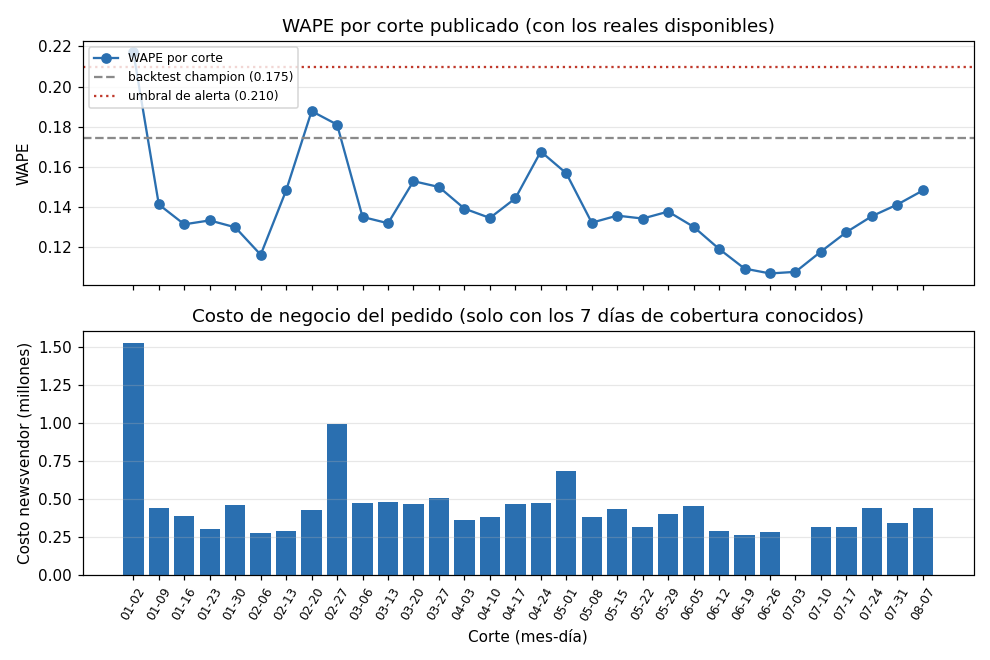
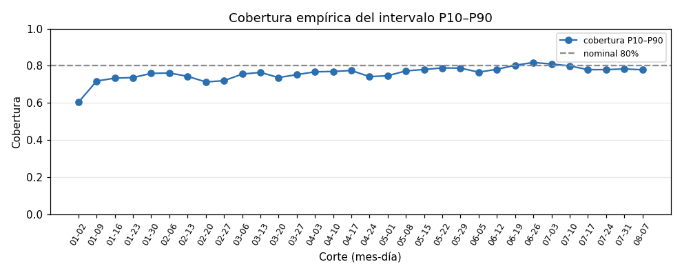
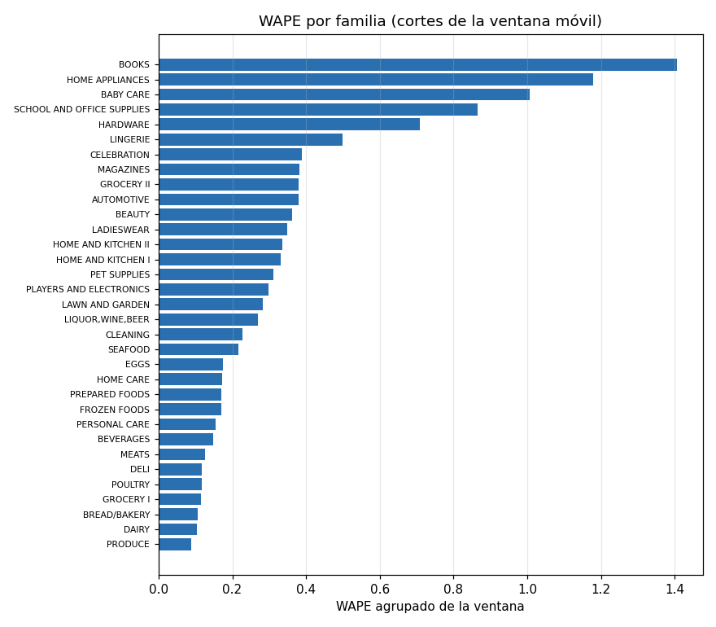

# Seguimiento del desempeño — corte de evaluación 2017-08-14

Compara cada pronóstico publicado con las ventas reales visibles en la fecha de evaluación (la última versión de cada día, así que las correcciones ya están incluidas). Un día sin real es *real pendiente*, no un error.

## Alerta de degradación

WAPE móvil 0.1366 vs backtest 0.1746 (-21.8%): dentro del umbral de 20%

- WAPE móvil (4 cortes: 2017-07-17, 2017-07-24, 2017-07-31, 2017-08-07): **0.1366**
- WAPE del backtest del champion (lgbm-2017-01-02-d1a22558): 0.1746
- Umbral: +20% (solo advertencia, sin reentrenamiento automático)

## Desempeño por corte (última revisión de cada corte)

| Corte | Rev | Estado | Días con real | WAPE | RMSLE | Sesgo | Cobertura P10–P90 | Costo | Costo total | Fill rate |
|---|---|---|---|---|---|---|---|---|---|---|
| 2017-01-02 | 1 | completo | 14 | 0.2172 | 0.5514 | -0.156 | 0.604 | completo | 1,524,326 | 0.7984 |
| 2017-01-09 | 1 | completo | 14 | 0.1413 | 0.4112 | -0.034 | 0.718 | completo | 440,487 | 0.9446 |
| 2017-01-16 | 1 | completo | 14 | 0.1314 | 0.4031 | -0.014 | 0.734 | completo | 387,662 | 0.9523 |
| 2017-01-23 | 1 | completo | 14 | 0.1334 | 0.4508 | -0.033 | 0.737 | completo | 301,973 | 0.9655 |
| 2017-01-30 | 1 | completo | 14 | 0.1300 | 0.4445 | -0.036 | 0.759 | completo | 457,989 | 0.9371 |
| 2017-02-06 | 2 | completo | 14 | 0.1163 | 0.5135 | +0.009 | 0.761 | completo | 278,878 | 0.9700 |
| 2017-02-13 | 1 | completo | 14 | 0.1483 | 0.5360 | +0.015 | 0.743 | completo | 285,933 | 0.9800 |
| 2017-02-20 | 1 | completo | 14 | 0.1878 | 0.5125 | -0.103 | 0.713 | completo | 429,938 | 0.9564 |
| 2017-02-27 | 1 | completo | 14 | 0.1811 | 0.4784 | -0.141 | 0.720 | completo | 989,108 | 0.8568 |
| 2017-03-06 | 1 | completo | 14 | 0.1351 | 0.4020 | -0.092 | 0.755 | completo | 471,417 | 0.9243 |
| 2017-03-13 | 2 | completo | 14 | 0.1320 | 0.4125 | -0.086 | 0.765 | completo | 481,125 | 0.9255 |
| 2017-03-20 | 1 | completo | 14 | 0.1529 | 0.5599 | -0.089 | 0.737 | completo | 465,286 | 0.9273 |
| 2017-03-27 | 1 | completo | 14 | 0.1500 | 0.5398 | -0.050 | 0.753 | completo | 509,013 | 0.9301 |
| 2017-04-03 | 1 | completo | 14 | 0.1393 | 0.4413 | -0.036 | 0.768 | completo | 363,482 | 0.9571 |
| 2017-04-10 | 1 | completo | 14 | 0.1346 | 0.4250 | -0.024 | 0.770 | completo | 378,907 | 0.9550 |
| 2017-04-17 | 1 | completo | 14 | 0.1444 | 0.6602 | -0.036 | 0.775 | completo | 464,567 | 0.9497 |
| 2017-04-24 | 1 | completo | 14 | 0.1677 | 0.4535 | -0.084 | 0.742 | completo | 475,237 | 0.9350 |
| 2017-05-01 | 1 | completo | 14 | 0.1569 | 0.4427 | -0.072 | 0.747 | completo | 683,989 | 0.9082 |
| 2017-05-08 | 2 | completo | 14 | 0.1323 | 0.4379 | -0.031 | 0.773 | completo | 380,388 | 0.9681 |
| 2017-05-15 | 1 | completo | 14 | 0.1358 | 0.4252 | -0.077 | 0.780 | completo | 435,448 | 0.9372 |
| 2017-05-22 | 1 | completo | 14 | 0.1343 | 0.4001 | -0.058 | 0.789 | completo | 314,672 | 0.9566 |
| 2017-05-29 | 1 | completo | 14 | 0.1378 | 0.3988 | -0.074 | 0.788 | completo | 400,081 | 0.9488 |
| 2017-06-05 | 1 | completo | 14 | 0.1302 | 0.4007 | -0.055 | 0.766 | completo | 455,613 | 0.9347 |
| 2017-06-12 | 1 | completo | 14 | 0.1192 | 0.3909 | -0.025 | 0.781 | completo | 290,211 | 0.9647 |
| 2017-06-19 | 1 | completo | 14 | 0.1094 | 0.3903 | -0.027 | 0.803 | completo | 265,122 | 0.9684 |
| 2017-06-26 | 1 | parcial | 13 | 0.1070 | 0.3768 | -0.012 | 0.818 | completo | 284,317 | 0.9768 |
| 2017-07-03 | 1 | parcial | 13 | 0.1078 | 0.3788 | -0.011 | 0.810 | pendiente | — | — |
| 2017-07-10 | 1 | completo | 14 | 0.1179 | 0.3889 | -0.009 | 0.800 | completo | 312,568 | 0.9739 |
| 2017-07-17 | 1 | completo | 14 | 0.1276 | 0.4067 | -0.046 | 0.779 | completo | 312,548 | 0.9688 |
| 2017-07-24 | 1 | completo | 14 | 0.1355 | 0.4292 | -0.046 | 0.779 | completo | 440,032 | 0.9380 |
| 2017-07-31 | 1 | completo | 14 | 0.1413 | 0.4355 | +0.001 | 0.783 | completo | 342,430 | 0.9684 |
| 2017-08-07 | 1 | parcial | 7 | 0.1483 | 0.4085 | +0.034 | 0.779 | completo | 439,193 | 0.9708 |
| 2017-08-14 | 1 | sin_datos | 0 | — | — | — | — | pendiente | — | — |

## Real pendiente (días que ya debieron llegar y faltan)

- Corte 2017-06-26 rev=1: sin real el 2017-07-04
- Corte 2017-07-03 rev=1: sin real el 2017-07-04

## Revisiones emitidas por correcciones

| Corte | Rev | Emitida en | Estado | WAPE |
|---|---|---|---|---|
| 2017-02-06 | 2 | 2017-02-13 | completo | 0.1163 |
| 2017-03-13 | 2 | 2017-03-20 | completo | 0.1320 |
| 2017-05-08 | 2 | 2017-05-15 | completo | 0.1323 |

## Desempeño por familia (ventana móvil)

| Familia | WAPE | Costo |
|---|---|---|
| BOOKS | 1.4056 | 44 |
| HOME APPLIANCES | 1.1792 | 166 |
| BABY CARE | 1.0074 | 109 |
| SCHOOL AND OFFICE SUPPLIES | 0.8646 | 28,564 |
| HARDWARE | 0.7085 | 316 |
| LINGERIE | 0.4996 | 990 |
| CELEBRATION | 0.3893 | 1,551 |
| MAGAZINES | 0.3823 | 674 |
| GROCERY II | 0.3806 | 9,460 |
| AUTOMOTIVE | 0.3797 | 741 |
| BEAUTY | 0.3625 | 601 |
| LADIESWEAR | 0.3498 | 1,089 |
| HOME AND KITCHEN II | 0.3356 | 3,514 |
| HOME AND KITCHEN I | 0.3313 | 3,595 |
| PET SUPPLIES | 0.3111 | 756 |
| PLAYERS AND ELECTRONICS | 0.2984 | 912 |
| LAWN AND GARDEN | 0.2835 | 1,159 |
| LIQUOR,WINE,BEER | 0.2691 | 9,616 |
| CLEANING | 0.2285 | 134,776 |
| SEAFOOD | 0.2158 | 4,491 |
| EGGS | 0.1755 | 34,175 |
| HOME CARE | 0.1717 | 16,057 |
| PREPARED FOODS | 0.1698 | 15,195 |
| FROZEN FOODS | 0.1698 | 23,830 |
| PERSONAL CARE | 0.1541 | 14,688 |
| BEVERAGES | 0.1479 | 367,199 |
| MEATS | 0.1253 | 45,243 |
| DELI | 0.1167 | 30,725 |
| POULTRY | 0.1164 | 43,331 |
| GROCERY I | 0.1145 | 367,893 |
| BREAD/BAKERY | 0.1071 | 63,743 |
| DAIRY | 0.1035 | 92,944 |
| PRODUCE | 0.0879 | 216,056 |

## Gráficos

